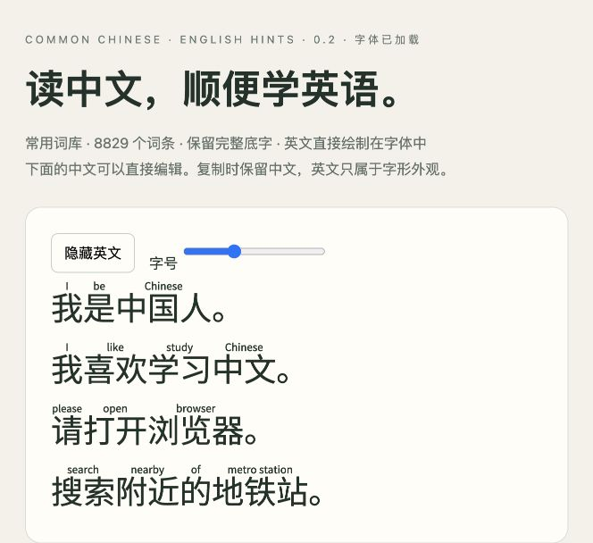

# Common Chinese English Sans

通用中文英文提示字体。中文词语上方显示简短英文，原文保持中文，可以照常复制、搜索。**英文是词汇提示，不是逐词拼起来就正确的英语译文。**



- 8,829 个英文标注词形，239 个整词保护规则。
- 默认开源底字 Noto Sans SC Regular，保留其 30,890 个字符映射。
- 最长词优先：“中国人”显示 Chinese；“中国”显示 China。
- 横排、Regular。输出安装用 OTF、网页用 WOFF2，以及轻量演示字体。

## 下载和发布

生成字体通过 [GitHub Releases](https://github.com/Matrixbirds/common-chinese-english-sans/releases) 分发。当前源码改造不代表已发布版本；若还没有 Release，请按下文自行构建。

main 保存代码、配置、词库和演示源码；`.cache/` 保存下载底字，`dist/` 保存构建结果，两者均不跟踪。不要将构建字体、内嵌字体的 HTML 或发行 ZIP 提交到 Git。

## 本地构建

需要 **Node.js 22.18+（建议 24）和 Python 3.10+**。使用 Node 的原生 TypeScript 执行能力，不需要全局安装 tsx 或 ts-node。

```sh
npm ci
python3 -m venv .venv
.venv/bin/pip install -r requirements.txt
npm run font:fetch
npm run check
npm test
npm run build
npm run package
npm run demo
```

浏览器打开 `http://127.0.0.1:8765/demo/`。预览通过 HTTP 读取词库，不要双击 HTML 用 file:// 打开。

Windows 可先激活虚拟环境，或通过环境变量 `PYTHON` 指定 Python 解释器。macOS/Linux 默认优先使用项目 `.venv/bin/python`。

`font:fetch` 下载 Noto Sans SC，并验证配置中的 SHA-256；已有缓存也要通过校验。下载失败可手动把配置 URL 的文件放到 `.cache/base.otf`，命令仍会验证摘要。上游文件变化时构建会停止，不会静默替换底字。

构建输出：

```text
dist/
  CommonChineseEnglishSans-Regular.otf
  CommonChineseEnglishSans-Regular.woff2
  preview-font.woff2
  plan.json
  build-report.json
  validation.json
  release/
    common-chinese-english-sans-v0.2.0.zip
    SHA256SUMS.txt
```

## 结构与实现

```text
src/planner.ts           TypeScript：词库校验、覆盖检查、最长匹配顺序、字形容量检查
src/cli.ts               TypeScript：底字下载校验、构建与验证命令
scripts/compiler.py     Python/fontTools：字形绘制、字体表写入、OTF/WOFF2 编译
scripts/verify.py       HarfBuzz：检查真实字体排版和原有字符/功能保留
scripts/package_release.py  打包字体与来源许可
font.config.json        底字来源、字体命名、字号比例、构建版本和时间
 data/                  可贡献的词库和整词保护列表
 demo/                  不内嵌字体与词库的轻量预览源码
 .github/workflows/      构建检查、版本标签发布
```

参考 [furifont 的分层设计](https://github.com/antfu/furifont/blob/main/docs/design.md)：词库 → 计划 → 字体编译 → 排版验证。本项目当前是 **TypeScript 规划层 + Python 编译层**，不是纯 TypeScript 字体编译器，也没有直接使用 furifont 源码。先保留成熟的 fontTools 二进制后端；未来可在计划接口不变的情况下替换为 TypeScript 后端。

当前后端支持静态 CFF OTF 底字，不支持 TTF、可变字体、竖排。默认只保证指定的 Noto Sans SC 底字。替换底字时要重新核对许可、哈希和尺寸参数；添加英文的默认坐标基于 Noto 的 1000 单位字框。

## 如何贡献

参见 [CONTRIBUTING.md](CONTRIBUTING.md)。最有价值的贡献是修正语义和保护词语，而不是盲目增加覆盖数量。

- 修改 `data/vocabulary.json` 的 `english`（完整提示）和 `annotation`（实际绘制的小字）。
- 多字词优先，不应把“电脑”拆成 electricity + brain。
- 不确定的词可以移出标注列表并加入 `data/protection.json`，整词不标，防止内部短词抢先匹配。
- 同一写法只能有一条规则，冲突会在 TypeScript 规划阶段报错。
- `data/vocabulary.csv` 是便于查阅的历史导出；构建以 JSON 为准。

常用范围来自 wordfreq 词频筛选、基础学习词和生活/电脑场景补充，并非官方“全部常用汉字”认定。645 种单字有独立提示；其余汉字仍正常显示。自动选义未逐条完成专业教学审校。

## 网页使用

```css
@font-face {
  font-family: 'Common Chinese English Sans';
  src: url('./CommonChineseEnglishSans-Regular.woff2') format('woff2');
}
.chinese {
  font-family: 'Common Chinese English Sans', sans-serif;
  font-feature-settings: 'rclt' 1;
  line-height: 1.9;
}
```

建议 28px 以上。`rclt` 设为 0 关闭英文。行尾换行、不同元素或字体段可能拆开一个词，导致整词规则不触发。字体只匹配固定文字，不理解上下文或英语时态。“我是中国人”上方是 I / be / Chinese，整句英语是 I'm Chinese。CL 表示量词。

## 许可与来源

**原创代码 MIT；字体 OFL；派生词库数据 CC BY-SA 4.0。不是所有文件都使用 MIT。** 见 [LICENSES.md](LICENSES.md)。

- Noto Sans SC： [noto-cjk](https://github.com/notofonts/noto-cjk)，SIL OFL 1.1；版权与原许可见 [OFL.txt](OFL.txt)，字体内保留底字版权元数据，修改字体已更名。
- CC-CEDICT：[项目](https://cc-cedict.org/)，[下载来源](https://www.mdbg.net/chinese/dictionary?page=cedict)。英文经过选义、删除附注、简化和人工修订。
- Robyn Speer 的 [wordfreq](https://github.com/rspeer/wordfreq)：使用中文频率桶筛选候选，是约 2021 年语言使用快照；完整上游署名见 [wordfreq-attribution.md](wordfreq-attribution.md)，包括自由可获取的 SUBTLEX（Marc Brysbaert、Cai 等）、Google Books、Wikipedia、OpenSubtitles 等来源。
- 基础词范围来自此前 HSK 1–3 级初版，本版范围不受考试等级限制。
